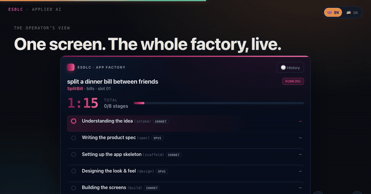
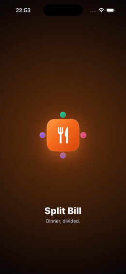

# ESDLC, an autonomous software delivery engine

ESDLC takes a client idea and builds a native iOS app: design, code, tests, launch on a device. A human approves twice, the spec and the release. This repo is the conference showcase: the slide deck, the agent skills for each stage and three apps the engine built.

  
   
  <em>Operator view: one job running the full pipeline, from intake to a shipped app. Click to open the live deck.</em>

Live deck: <https://vlaskos.github.io/app-factory/>

> The deck is one self-contained HTML file, no build step. Use ← / → to navigate and L to switch English / Ukrainian.

## What it is

ESDLC is an autonomous, spec-driven SDLC on an agent harness. The input is a written spec with acceptance criteria. It drives the design, the code and the tests that verify it. The pipeline has ten stages from intake to release. A human approves the spec and the ship, the stages in between run on their own.

## How it works

The core is a harness, a trusted deterministic orchestrator around the model. The model only returns data (JSON). It never touches the machine and never gets a shell. The harness validates every value against strict allow-lists and assembles the app across three isolated zones:

- **untrusted**: the raw client text. Sanitized on the way in, sees no secrets.
- **agent**: the model as a pure generator. Returns artifacts as data only.
- **harness (trusted)**: validates, writes files, runs the build and the tests, owns signing.

Because the model only returns data, a hostile prompt can change how the app looks, but not what the code does or what the machine runs. So it's safe to point at untrusted input.

## What's in this repo

| Path | What |
|---|---|
| `index.html` | The deck, one self-contained file. GitHub Pages serves it |
| `skills/` | The ten pipeline skills (intake → release) the harness loads per stage |
| `architecture-kit/` | The standing iOS architecture kit every generated app obeys |
| `examples/` | Three apps the engine built, compilable Swift |

## What's intentionally not here

- **The spine**, the orchestrator itself. It's the engine's implementation, so it stays private.
- **Vendored third-party skills** are not redistributed here. They are listed with author, source, and pinned commit in [VENDORED-SKILLS.md](VENDORED-SKILLS.md), so the set stays reproducible and properly credited.

## Example apps

`examples/` holds three local-only apps the pipeline produced end to end: a bill-splitter, a calculator and a shopping list. Each has its SwiftUI sources, an XcodeGen `project.yml` and swift-testing suites. They target the current iOS baseline (Swift 6, SwiftUI, Observation, SwiftData).

  
   
  <em>Split Bill, one of the generated apps, on a device.</em>

## Running the deck

It's a single file. Open `index.html` in any browser. To serve it on the web, enable **GitHub Pages**: *Settings → Pages → Deploy from a branch → `main` → `/ (root)`*. GitHub publishes it at the URL above within a minute.

## Credits

The pipeline's Swift knowledge comes from open-source agent skills by Paul Hudson, Thomas Ricouard and others, each MIT-licensed and vendored at a pinned commit. See [VENDORED-SKILLS.md](VENDORED-SKILLS.md) for the full list and attribution. Apple's Human Interface Guidelines are referenced as design guidance only; this project is not affiliated with or endorsed by Apple.

## License

[MIT](LICENSE) © 2026 Vladyslav Kosyi. The example apps and the original skills in `skills/` and `architecture-kit/` are covered by this license; third-party vendored skills retain their own (see [VENDORED-SKILLS.md](VENDORED-SKILLS.md)).
